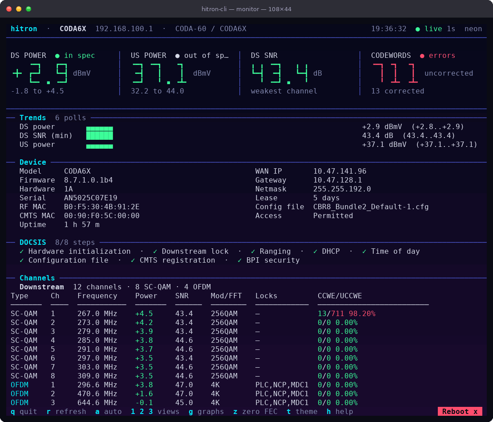

# hitron-cli (Go)



_Captured against a replay of a real CODA-60 with the serial, MACs and IPs replaced. `demo/` has the replay server and renderer._

A standalone terminal client for the three Hitron families this repository
documents. It is a single static binary with no runtime, no config file, and no
dependencies outside the Go standard library.

| Device | API | Detection probe |
| --- | --- | --- |
| CODA6X (CODA-60) | `/1/Device/...` JSON | `GET /1/Device/CM/Version` |
| CODA 4x8x (CODA-4582, CODA-4680; **experimental, read-only**) | CODA6X-style JSON from the site root, no `/1/Device` prefix (hypothesis) | `GET /CM/Version` |
| CODA-57 | `/data/*.asp` JSON | `GET /data/getSysInfo.asp` |
| HT-EM5 | `/ms/<type>/<reg>` MoCA RPC | `GET /index.html` + `POST /ms/1/0x302/GET` |

Detection tries the CODA6X, then the CODA 4x8x, then the CODA-57, then the
HT-EM5. The CODA 4x8x probe never sends credentials, so a unit that gates its
reads behind a login is not auto-detected.

**CODA 4x8x status: experimental, not verified on live hardware.** The working
hypothesis is that these modems serve the same REST data model the CODA6X
client already parses (`/CM/DsInfo`, `/CM/UsInfo`, `/CM/DsOfdm`, `/CM/UsOfdm`,
`/CM/Log`, `/CM/SysInfo`, ...) from the site root. The route names and the
login shape match; the field names are reconstructed, not confirmed. The
family is read-only by policy: reboot, factory reset, hard reset, FEC reset,
and the spectrum and constellation views return "not supported on CODA 4x8x
(experimental, read-only)" and send nothing to the device. The endpoint list
and login flow come from the MIT-licensed
[hairyhenderson/hitron_coda](https://github.com/hairyhenderson/hitron_coda)
project (facts only, no code); credit to it. Login, if a unit wants one, is
`POST /Users/Login` with the same `model=<json>` form body.

The Python package in `src/hitron/` remains the exporter and library. This
binary exists for the case where you want to walk up to a modem and read it
from a laptop with nothing installed.

Per-release changes and fixes: [`CHANGELOG.md`](CHANGELOG.md).

## Build

```bash
cd cli
go build -o hitron-cli ./cmd/hitron-cli
./hitron-cli version
```

Go 1.22 or newer. Cross-compiling is the usual `GOOS`/`GOARCH` pair:

```bash
GOOS=linux GOARCH=amd64 CGO_ENABLED=0 go build -o hitron-cli-linux ./cmd/hitron-cli
```

Tagged releases (`cli/v*`) build Linux, macOS, and Windows binaries for amd64
and arm64 in `.github/workflows/cli-release.yml`; each file ships with a
`.sha256`.

## Install from a release

Download the file for your platform, then:

```bash
chmod +x hitron-cli_darwin_arm64
sudo mv hitron-cli_darwin_arm64 /usr/local/bin/hitron-cli
hitron-cli help
```

## Commands

```text
hitron-cli stats            one-shot report, or live TUI in a terminal (default)
hitron-cli monitor          force the live TUI
hitron-cli detect           identify CODA6X / CODA 4x8x / CODA-57 / HT-EM5
hitron-cli system           identity, provisioning, Ethernet ports
hitron-cli channels         downstream and upstream RF detail
hitron-cli logs             DOCSIS event log
hitron-cli moca             HT-EM5 link, bands, nodes
hitron-cli reboot           reboot (prompts, or --confirm)
hitron-cli factory-reset    factory reset + reboot (CODA6X)
hitron-cli hard-reset       immediate restoreReset + reboot (CODA6X)
hitron-cli fec-reset        clear the downstream FEC counters (CODA6X)
hitron-cli pwod             password of the day (CODA6X, offline)
hitron-cli help [topic]     overview or one topic
hitron-cli version          version
```

If the command is omitted, `stats` runs. Running `stats` in a real terminal
opens the live view; piping it or using `--once`/`--json` prints one report and
exits, which is what the TUI-less cases need.

### Flags

| Flag | Meaning |
| --- | --- |
| `-H`, `--host HOST` | gateway address, default `192.168.100.1` |
| `-u`, `--user NAME` | username for authenticated reads and writes |
| `-p`, `--password PASS` | password |
| `--token TOKEN` | CODA6X `Ht-App-Auth` app token |
| `--timeout 10s` | per-request timeout |
| `--interval 5s` | live refresh interval |
| `--limit 20` | log lines in the one-shot report |
| `--once` | one report, never the TUI |
| `--json` | machine-readable snapshot |
| `--no-color` | disable ANSI color |
| `--confirm` | skip the y/N prompt on a destructive command |
| `--no-banner` | suppress the startup art |
| `-h`, `--help` | help |
| `-V`, `--version` | version |

The host can also be a positional argument, a hostname, or a URL with a port:
`hitron-cli 192.168.100.1`, `hitron-cli 127.0.0.1:8080`,
`hitron-cli http://192.168.100.1`.

### Environment

| Variable | Meaning |
| --- | --- |
| `HITRON_HOST` / `HITRON_DEVICE` | default host |
| `HITRON_USERNAME` | username |
| `HITRON_PASSWORD` | password |
| `HITRON_APP_TOKEN` | CODA6X app token |
| `HITRON_TIMEOUT` | timeout in seconds |
| `HITRON_INTERVAL` | refresh interval (`5s`, `500ms`, or seconds) |
| `NO_COLOR` | disable ANSI color |

Flags override the environment.

## Authentication

Reads answer anonymously on the analyzed CODA6X firmware and (per the captured
unit) the CODA-57 `.asp` API. The CLI still handles the gates honestly:

* **CODA6X**: writes `POST /1/Device/Users/Login` with the firmware's
  `model={"username":...,"password":...}` form, then reuses the session cookie.
  `--token` sends `Ht-App-Auth` instead.
* **CODA-57**: `GET /login.html` primes a `PHPSESSID`. No credential POST has
  been confirmed against real hardware, so the CLI does not invent one; a gated
  device is reported, not guessed at.
* **HT-EM5**: HTTP Basic on every request. The factory image defaults to
  `admin`/`admin`, which the detector uses only when no credentials were
  supplied. It fetches `/index.html` for the `csrf_token` cookie and echoes it
  as `X-CSRF-TOKEN`.

When a device asks for a login and stdin is a terminal, the CLI prompts once
and retries. With `--json` or no terminal it exits with a clear error instead
of hanging.

## Writes

Three destructive verbs, each requiring credentials:

| Command | CODA6X body | HT-EM5 | CODA-57 |
| --- | --- | --- | --- |
| `reboot` | `{"reboot":1,"factoryReset":0,"restoreReset":0}` to `CM/Reboot` | `POST /ms/1/0xb00/PUT {"data":[1]}` | unsupported |
| `factory-reset` | `{"reboot":0,"factoryReset":1,"restoreReset":0}` | unsupported | unsupported |
| `hard-reset` | `{"reboot":0,"factoryReset":0,"restoreReset":1}` | unsupported | unsupported |

One non-destructive write needs no session, no prompt, and no credentials:

| Command | CODA6X | HT-EM5 | CODA-57 |
| --- | --- | --- | --- |
| `fec-reset` | bare `PUT CM/DsInfo`, repeated bare `PUT CM/DsOfdm` | unsupported | unsupported |

`fec-reset` only zeroes counters, so it acts immediately; `--json` makes it
scriptable. It is the command-line form of the TUI's `z` key.

The handler reads all three reboot flags before choosing a branch, so the body is
always the full triple; a partial body is a PHP 8 fatal (HTTP 500), not
`errCode 001`. Only `hard-reset` has been measured working: the connection drops
with no reply, the unit is unreachable ~5 s later and back ~122 s after that.

Every one of the three verbs asks:

```text
Reboot CODA-60 / CODA6X at 192.168.100.1? This acts on the real device. [y/N]
```

Only `--confirm` (or `-y`) skips that question. It never removes the
credential requirement, and the CLI calls `Login` immediately before acting so
the write is one traceable operation. Answering no exits 1.

CODA-57 has no confirmed write path in this repository. The CLI says so and
stops; it does not try a plausible-looking URL on a live modem. The same is
true of the experimental CODA 4x8x, where every write command fails with the
typed read-only error before any request is made.

## Live view

`monitor`, or `stats` in a terminal, draws a full-screen report and refreshes
on `--interval` (default 5s; 1s on the CODA-57 and CODA-60).

The summary opens with four big-number cards (downstream power, upstream
power, weakest downstream SNR, uncorrectable codewords), then trend graphs, a
device block (serial, RF MAC, CMTS MAC, firmware, config file), the DOCSIS
provisioning steps, typed channel tables with a `CCWE/UCCWE` codeword column
and a decoded, shortened event log. The mouse wheel scrolls.

| Key | Action |
| --- | --- |
| `q` | quit |
| `r`, `space` | refresh now |
| `a` | toggle automatic refresh |
| `g` | toggle trend graphs |
| `z` | reset the downstream FEC counters (3.0 + OFDM). Writes on the CODA6X; on other families it only zeroes the displayed counts. |
| `t` | next color theme, remembered for next time |
| `b` | toggle the gradient background (24-bit color terminals only) |
| `x`, the Reboot button | reboot, after a confirmation (see below) |
| `j`, `k`, arrows | scroll |
| `h`, `?` | help overlay |
| `1` | summary |
| `2`, `s` | live spectrum |
| `3`, `c` | constellation (I/Q) |
| `[`, `]` | previous / next analyzer channel |
| `,`, `.` | fine-tune the spectrum center by 1 MHz |

Themes are `neon` (default), `synthwave`, `dracula`, `nord`, `gruvbox` and
`matrix`. Choose one with `--theme NAME` or `HITRON_THEME`; the `t` key saves
your choice. `--no-bg` turns off the background and `--no-mouse` stops the
mouse being captured so text can be selected normally.

**`z` (FEC counters)** writes on the CODA6X: one bare `PUT /1/Device/CM/DsInfo`,
then up to eight bare `PUT /1/Device/CM/DsOfdm` calls, re-reading the counters
and putting the result on the status line. The 3.0 stop clears every busy
channel in one call; the OFDM stop is unreliable on this build, so the report
keeps the best observation and names any channel still counting. Channels that
were already at zero are reported as already clean, not as cleared. On a
family with no confirmed FEC endpoint, `z` falls back to zeroing the displayed
counts without writing; pressing it again restores them.

`hitron-cli fec-reset` runs the same clear headlessly, with no credentials and
no prompt, and prints the same counts (`--json` for scripts).

**Reboot** is the other write. `x` (or a click on the Reboot button) opens a
dialog that asks you to type the word `reboot`; nothing is sent before that.
The CODA6X accepts the reboot from the LAN without a login, so no credentials
are requested; `--user` and `--password` are used only if the device refuses
the anonymous call. The HT-EM5 asks for its login, and the CODA-57 has no
reboot button. Factory reset and hard reset are not in the TUI; they stay
separate commands with their own confirmation.

### Spectrum and constellation

Both views read `/1/Device/Spectrum` on the CODA6X and are unavailable on the
other families. The firmware drives one shared hardware tuner, so the client
keeps captures sequential and draws whatever the tuner actually returned:

- **Spectrum** is a braille trace of one 6 MHz window (300 points at 20 kHz
  spacing on a CODA-60). `[`/`]` jumps between the analyzer's downstream
  channels, `,`/`.` tunes by 1 MHz. The header carries the raw min/max/average
  dBmV; the vertical axis trims the tuner's 30–40 dB edge roll-off so the
  channel itself fills the panel. The `RTData` power/MER snapshot sits below it.
- **Constellation** plots the 256 I/Q samples for one analyzer port, auto-scaled
  to the returned cloud, with modulation, bandwidth, MER, and power in the
  header. Ports are the analyzer's own ids (a live CODA-60 reports `0, 25..31`
  for eight downstream channels), not DOCSIS channel numbers.

`FreqPower` only accepts at most one non-zero fractional digit (`637.5`, never
`637.500`); a value that misses the handler's regex silently falls back to the
645/637.5/643.5 defaults. The client formats frequencies accordingly.

An inactive constellation port, or a tuner that has not settled, answers `200`
with an empty list. The TUI says so instead of treating it as an error.

## Exit codes

| Code | Meaning |
| --- | --- |
| `0` | success |
| `1` | device, network, or action error (including an aborted confirmation) |
| `2` | usage error (bad flag, missing credentials for a write) |

A single failed endpoint does not fail the run: the report prints what it got
under **Partial data** and the JSON snapshot carries a `warnings` array.

## Tests

```bash
cd cli
go vet ./...
go test ./...
```

The suite is offline. It uses `httptest` fixtures shaped like the captured
CODA6X responses (null OFDM slots, `-inf` power sentinels, `"v6 / v4"` WAN
addresses, newest-first logs) and checks detection, login, reboot bodies, and
the parser edge cases.
